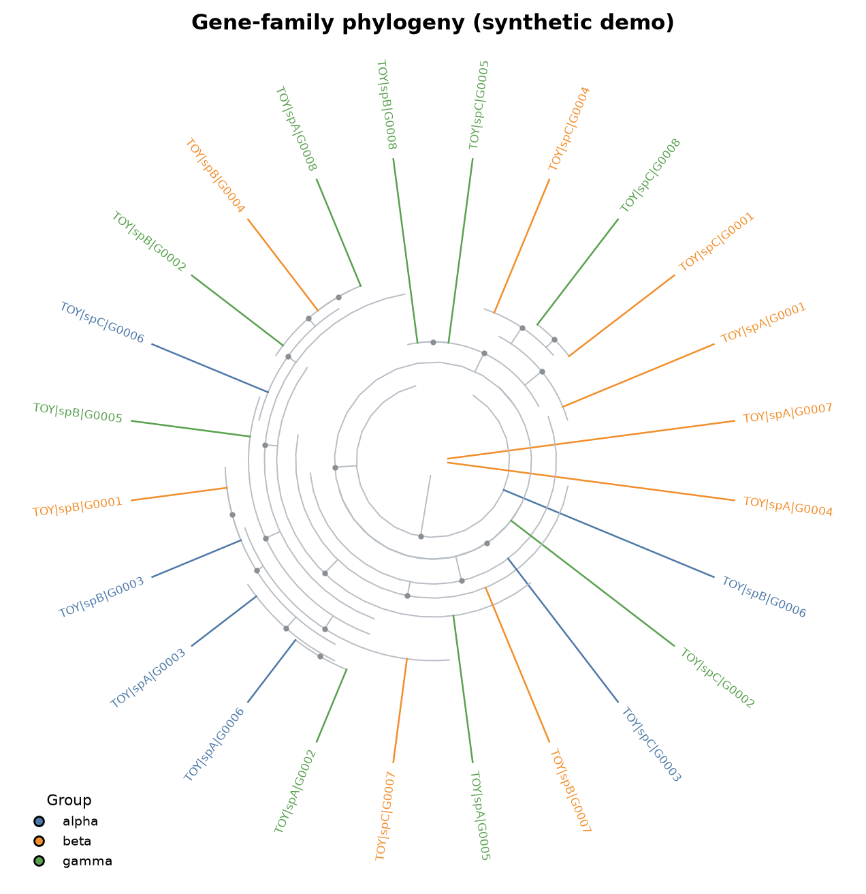
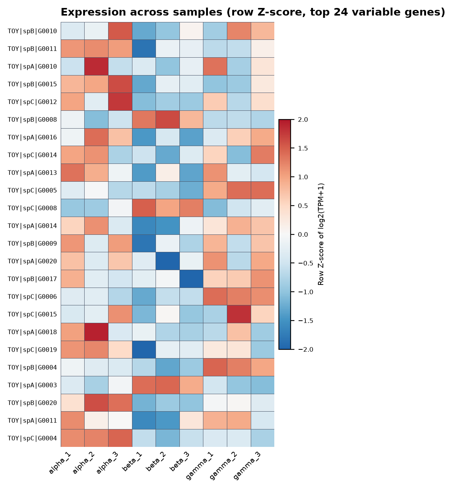

# genefamily-workflow

A small, reproducible pipeline for gene-family analysis:
**domain-based discovery → multiple sequence alignment → maximum-likelihood phylogeny → structure / domain / expression figures**.

Everything in this repository runs on a **synthetic dataset** that is generated at runtime.
No experimental data, sample names, coordinates or expression values are shipped or required.

[](https://github.com/wujunhao0226/genefamily-workflow/actions/workflows/ci.yml)


## Example output

Both panels come from the synthetic demo (`bash scripts/run_toy_pipeline.sh`); no experimental data is involved.

<p align="center">
  
  
</p>

---

## Why

Gene-family papers usually start from a profile HMM search and end with a pile of
ad-hoc scripts. This repository turns that path into a single command with explicit
inputs, checks and artefacts, so the analysis can be re-run and reviewed.

```
proteome.faa ──hmmsearch──► hits.faa ──clustalo──► alignment.faa ──IQ-TREE──► tree.treefile
                                                     │                         │
GFF3 ──structure──► exon/intron tables               │                         │
counts.tsv ──TPM/Z──► expression tables ─────────────┴──► figures (heatmap, circular tree, gene models)
```

## Quick start

```bash
python -m venv .venv && source .venv/bin/activate
pip install -e ".[dev]"

# 1) generate the synthetic dataset (60 proteins, 24 with a planted motif)
genefamily toy --outdir data/toy

# 2) run the full pipeline (needs hmmer, clustalo, iqtree on PATH)
genefamily run --config config/toy.yaml

# or only the pure-Python steps, no external binaries
genefamily run --config config/toy.yaml --skip-external
```

External tools, if you do not have them:

```bash
micromamba create -n gf -c conda-forge -c bioconda python=3.11 hmmer clustalo iqtree
micromamba activate gf
```

## Commands

| command | what it does |
|---|---|
| `genefamily toy` | writes a seeded synthetic dataset (`data/toy/`) |
| `genefamily discover` | builds a profile HMM, runs `hmmsearch`, filters hits, extracts sequences |
| `genefamily align` | Clustal Omega / MAFFT wrapper + gap-fraction sanity check |
| `genefamily tree` | IQ-TREE (`-m MFP -B 1000`) and returns the treefile |
| `genefamily domains` | parses RPS-BLAST output, removes redundant hits, summarises per protein |
| `genefamily structure` | exon/intron coordinates and lengths from GFF3 |
| `genefamily expression` | TPM (full-library denominator) and row Z-scores |
| `genefamily figures` | heatmap, circular tree, gene-model panel |
| `genefamily run` | executes the whole chain from a YAML config |

Run `genefamily <command> --help` for options.

## Outputs

```
results/
├─ discover/            hmmsearch.tblout, hits.tsv, ids.txt, hits.faa
├─ alignment.faa        MSA used for the tree
├─ tree.treefile        IQ-TREE maximum-likelihood tree
├─ gene_structure.tsv   exon/intron geometry per transcript
├─ tpm.tsv, zscore.tsv  normalised expression matrices
├─ expression_summary.tsv
├─ domain_summary.tsv   domain types and positions per protein
├─ figures/             circular_tree.{png,pdf}, expression_heatmap.*, gene_models.*
└─ manifest.tsv         every produced file with its size
```

## Data policy

This repository contains **no laboratory data**. See [DATA_POLICY.md](DATA_POLICY.md).

- `data/toy/` – synthetic, regenerated by `genefamily toy`
- `data/raw/` – your own inputs, git-ignored
- `results/` – outputs, git-ignored

CI only ever executes the synthetic dataset, so build logs cannot leak private sequences.

## Testing

```bash
pytest -q            # unit + end-to-end tests on synthetic data
ruff check src tests
bash scripts/run_toy_pipeline.sh   # full pipeline, needs the external binaries
```

The GitHub Actions workflow runs both jobs: unit tests on Python 3.9/3.11, and a full
HMMER → Clustal Omega → IQ-TREE run inside a micromamba environment, uploading the
resulting figures as a build artefact.

## Design notes

- **TPM uses the whole matrix as the library**, not the selected subset — a subtle bug
  that inflates values when only a gene family is normalised.
- **Hits are collapsed per gene by default** (`--keep-isoforms` to disable), so one
  locus cannot dominate a phylogeny through its transcripts.
- **Domain redundancy** is resolved in two passes: best specific hit per overlapping
  region, then superfamily hits that do not conflict with a specific one.
- **Figures** use a truncated ColorBrewer RdBu map (blue–white–red, no near-black ends)
  so low values survive both colour and greyscale printing.

## License

MIT — see [LICENSE](LICENSE).
